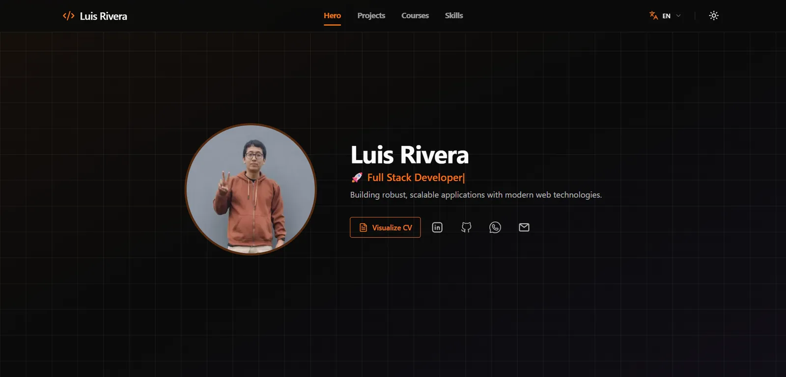

<div align="center">

[English](README.md) · [Español](README.es.md)

# Luis Rivera

### Desarrollador Full Stack

Construyo aplicaciones robustas y escalables con tecnologías web modernas — desde backends con gran volumen de datos hasta interfaces cuidadas y accesibles.

[](https://github.com/LuisRivera369/LuisRivera369.github.io/actions/workflows/deploy.yml)


[**Sitio en vivo**](https://LuisRivera369.github.io/es/) · [**CV**](https://LuisRivera369.github.io/documentos/CV-Luis-Rivera.pdf) · [**LinkedIn**](https://www.linkedin.com/in/luis-rivera-a98166221) · [**Email**](mailto:luis.rivera.dev.99@gmail.com)

</div>



## Sobre el proyecto

Este es mi portafolio personal: un sitio bilingüe (inglés / español) de una sola página, con una página de caso de estudio dedicada a cada proyecto. Es un **export completamente estático** — sin runtime de servidor — construido con el App Router de Next.js y desplegado en GitHub Pages mediante GitHub Actions.

Además del diseño, el repositorio sirve como muestra de cómo me gusta construir:

- **Contenido basado en datos.** Los proyectos, cursos, habilidades y el perfil viven en archivos tipados dentro de `src/data/`, así que agregar una entrada no requiere tocar componentes.
- **Internacionalización real.** Cada idioma se prerenderiza con sus propios metadatos, URL canónica y mapa `hreflang`.
- **Arquitectura estática primero.** El mismo build funciona en GitHub Pages, en un dominio propio o en cualquier host estático.
- **Accesibilidad y rendimiento.** Marcado semántico, navegación por teclado, soporte para `prefers-reduced-motion` y un tema que nunca destella.

## Características

- **Hero** con roles animados y descarga del CV.
- **Proyectos** con filtros por categoría, páginas de caso de estudio y sugerencias de proyectos relacionados.
- **Cursos** con filtro por institución y enlaces a credenciales.
- **Habilidades** agrupadas por área (frontend, backend, herramientas y datos).
- **Rutas bilingües** — `/en/` y `/es/`, con sitemap, robots y metadatos por idioma.
- **Tema claro / oscuro** aplicado antes del primer pintado (sin destello del tema incorrecto).
- **Navegación que sigue la página** — scroll suave e indicador de sección activa.
- **SEO esencial** — Open Graph, Twitter cards, JSON-LD `Person`, URLs canónicas y `hreflang`.
- **Export estático** — `output: "export"`, rutas con barra final y `404.html` generado.

## Stack tecnológico

| Capa | Herramientas |
| --- | --- |
| Framework | Next.js 16 (App Router), React 19, TypeScript 5 |
| UI y estilos | Tailwind CSS 4, daisyUI 5, Framer Motion, lucide-react |
| Internacionalización | next-intl 4 (rutas por prefijo, `localePrefix: "always"`) |
| Estado | Zustand, contexto de React + `useSyncExternalStore` |
| Contenido | Módulos de datos tipados + catálogos de mensajes JSON |
| Iconos | `@iconify/react` con colecciones remotas |
| Despliegue | GitHub Pages + GitHub Actions |

## Estructura del proyecto

```text
src/
├── app/
│   ├── [locale]/            # Layout por idioma, home y páginas de detalle
│   ├── global-not-found.tsx # Documento 404 estático
│   ├── robots.ts
│   └── sitemap.ts
├── components/
│   ├── layout/              # Navbar, menú móvil, tracker de sección activa
│   ├── seo/                 # JSON-LD
│   └── ui/                  # Cards, badges, tabs y controles reutilizables
├── data/                    # Contenido tipado (única fuente de verdad)
├── features/                # Hero, proyectos, cursos, habilidades, footer
├── hooks/
├── i18n/                    # Configuración de rutas y request
├── lib/                     # URLs del sitio, bootstrap del tema, utilidades
├── providers/
├── stores/
└── types/

messages/                    # en.json y es.json
public/                      # Imágenes, badges, CV y archivos para el host estático
scripts/                     # Servidor local de previsualización estática
```

## Empezar

### Requisitos

- **Node.js 24**
- **pnpm 12** (`packageManager` está fijado en `package.json`)

### Desarrollo

```bash
pnpm install
pnpm dev
```

Abre [http://localhost:3000/en/](http://localhost:3000/en/) o [http://localhost:3000/es/](http://localhost:3000/es/). En desarrollo, `/` redirige a `/en/`.

### Build y previsualización

```bash
pnpm build     # genera el sitio estático en out/
pnpm preview   # sirve out/ en http://localhost:4173
```

`pnpm preview` usa `scripts/serve-static.mjs`, un servidor pequeño que imita el comportamiento de un host estático: respeta `basePath`, resuelve rutas de directorio a `index.html` y cae en `404.html` cuando corresponde.

## Personalizar el contenido

El sitio está pensado para editarse sin tocar componentes:

| Qué | Dónde |
| --- | --- |
| Nombre, foto, CV y redes | `src/data/profile.ts` |
| Proyectos y casos de estudio | `src/data/projects.ts` |
| Cursos y credenciales | `src/data/courses.ts` |
| Habilidades y categorías | `src/data/skills.ts` |
| Textos de la interfaz (inglés / español) | `messages/en.json`, `messages/es.json` |
| Imágenes, badges y PDFs | `public/imagenes/`, `public/documentos/` |

## Scripts

| Comando | Descripción |
| --- | --- |
| `pnpm dev` | Inicia el servidor de desarrollo |
| `pnpm build` | Genera el export estático en `out/` |
| `pnpm preview` | Sirve el export estático en el puerto 4173 |
| `pnpm lint` | Ejecuta ESLint |

## Notas

- Los iconos de habilidades se obtienen de `api.iconify.design` en tiempo de ejecución, por lo que el build estático no los incluye.
- La detección de idioma está desactivada a propósito: la URL es la única fuente de verdad, lo que mantiene el output estático predecible.
- Cada push a `main` reconstruye y despliega el sitio en GitHub Pages automáticamente.

## Contacto

- **Email:** [luis.rivera.dev.99@gmail.com](mailto:luis.rivera.dev.99@gmail.com)
- **LinkedIn:** [luis-rivera-a98166221](https://www.linkedin.com/in/luis-rivera-a98166221)
- **GitHub:** [@LuisRivera369](https://github.com/LuisRivera369)
- **Portafolio:** <https://LuisRivera369.github.io/es/>

## Licencia

Proyecto personal. El código se comparte como referencia; el contenido, el CV, las imágenes y la identidad personal son © Luis Rivera y no están pensados para reutilizarse.
