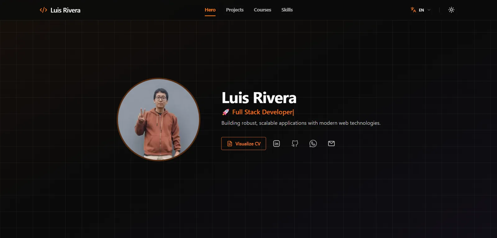

<div align="center">

[English](README.md) · [Español](README.es.md)

# Luis Rivera

### Full Stack Developer

Building robust, scalable applications with modern web technologies — from data-heavy backends to polished, accessible interfaces.

[](https://github.com/LuisRivera369/LuisRivera369.github.io/actions/workflows/deploy.yml)


[**Live site**](https://LuisRivera369.github.io/) · [**Résumé**](https://LuisRivera369.github.io/documentos/CV-Luis-Rivera.pdf) · [**LinkedIn**](https://www.linkedin.com/in/luis-rivera-a98166221) · [**Email**](mailto:luis.rivera.dev.99@gmail.com)

</div>



## About

This is my personal portfolio: a bilingual (English / Spanish) single-page site with a dedicated case-study page for every project. It is a **fully static export** — no server runtime — built with the Next.js App Router and deployed to GitHub Pages through GitHub Actions.

Beyond the design, the repository doubles as a sample of how I like to build:

- **Data-driven content.** Projects, courses, skills and profile data live in typed files under `src/data/`, so adding an entry does not require touching components.
- **Real internationalization.** Every locale is prerendered, with its own metadata, canonical URL and `hreflang` map.
- **Static-first architecture.** The same build works on GitHub Pages, a custom domain or any static host.
- **Accessibility and performance in mind.** Semantic markup, keyboard-friendly navigation, reduced-motion support and a theme that never flashes.

## Features

- **Hero** with animated roles and a downloadable résumé.
- **Projects** with category filters, case-study pages and related-project suggestions.
- **Courses** with institution filters and credential links.
- **Skills** grouped by area (frontend, backend, dev tools, data tools).
- **Bilingual routing** — `/en/` and `/es/`, with per-locale sitemap, robots and metadata.
- **Dark / light theme** applied before first paint (no flash of the wrong theme).
- **Navigation that follows the page** — smooth scrolling and an active-section indicator.
- **SEO essentials** — Open Graph, Twitter cards, JSON-LD `Person`, canonical URLs and `hreflang`.
- **Static export** — `output: "export"`, trailing-slash routes and a generated `404.html`.

## Tech stack

| Layer | Tools |
| --- | --- |
| Framework | Next.js 16 (App Router), React 19, TypeScript 5 |
| UI & styling | Tailwind CSS 4, daisyUI 5, Framer Motion, lucide-react |
| Internationalization | next-intl 4 (path-based routing, `localePrefix: "always"`) |
| State | Zustand, React context + `useSyncExternalStore` |
| Content | Typed data modules + JSON message catalogs |
| Icons | `@iconify/react` with remote collections |
| Deployment | GitHub Pages + GitHub Actions |

## Project structure

```text
src/
├── app/
│   ├── [locale]/            # Locale layout, home page and project detail pages
│   ├── global-not-found.tsx # Static 404 document
│   ├── robots.ts
│   └── sitemap.ts
├── components/
│   ├── layout/              # Navbar, mobile menu, active-section tracker
│   ├── seo/                 # JSON-LD
│   └── ui/                  # Reusable cards, badges, tabs, controls
├── data/                    # Typed portfolio content (single source of truth)
├── features/                # Hero, projects, courses, skills, footer
├── hooks/
├── i18n/                    # Routing and request configuration
├── lib/                     # Site URLs, theme bootstrap, utilities
├── providers/
├── stores/
└── types/

messages/                    # en.json and es.json
public/                      # Images, badges, CV and static-host files
scripts/                     # Local static preview server
```

## Getting started

### Requirements

- **Node.js 24**
- **pnpm 12** (`packageManager` is pinned in `package.json`)

### Development

```bash
pnpm install
pnpm dev
```

Open [http://localhost:3000/en/](http://localhost:3000/en/) or [http://localhost:3000/es/](http://localhost:3000/es/). In development, `/` redirects to `/en/`.

### Build and preview

```bash
pnpm build     # writes the static site to out/
pnpm preview   # serves out/ at http://localhost:4173
```

`pnpm preview` uses `scripts/serve-static.mjs`, a small server that mirrors how a static host behaves: it respects `basePath`, resolves directory routes to `index.html` and falls back to `404.html`.

## Customize the content

The site is designed to be edited without touching components:

| What | Where |
| --- | --- |
| Name, photo, résumé, social links | `src/data/profile.ts` |
| Projects and case studies | `src/data/projects.ts` |
| Courses and credentials | `src/data/courses.ts` |
| Skills and categories | `src/data/skills.ts` |
| UI copy (English / Spanish) | `messages/en.json`, `messages/es.json` |
| Images, badges, PDFs | `public/imagenes/`, `public/documentos/` |

## Scripts

| Command | Description |
| --- | --- |
| `pnpm dev` | Start the development server |
| `pnpm build` | Generate the static export in `out/` |
| `pnpm preview` | Serve the static export locally at port 4173 |
| `pnpm lint` | Run ESLint |

## Notes

- Skill icons are fetched from `api.iconify.design` at runtime, so the static build does not bundle them.
- Locale detection is disabled on purpose: the URL is the only source of truth, which keeps static output predictable.
- Every push to `main` rebuilds and deploys the site to GitHub Pages automatically.

## Contact

- **Email:** [luis.rivera.dev.99@gmail.com](mailto:luis.rivera.dev.99@gmail.com)
- **LinkedIn:** [luis-rivera-a98166221](https://www.linkedin.com/in/luis-rivera-a98166221)
- **GitHub:** [@LuisRivera369](https://github.com/LuisRivera369)
- **Portfolio:** <https://LuisRivera369.github.io/>

## License

Personal project. The source code is shared for reference; the content, résumé, images and personal branding are © Luis Rivera and are not intended for reuse.
